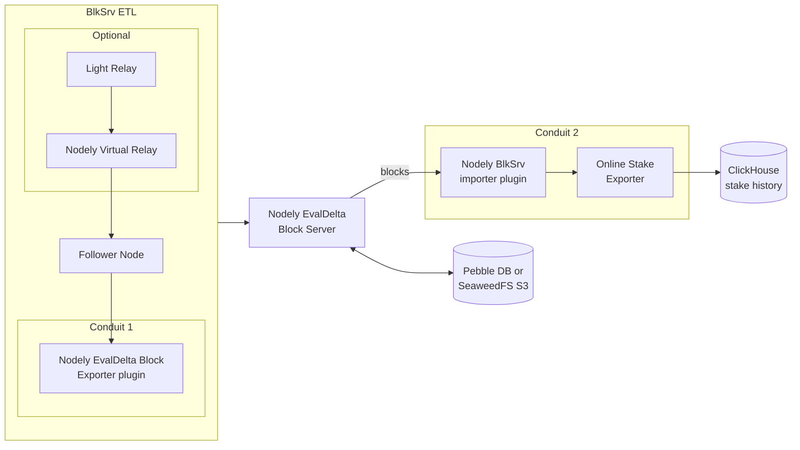

# Nodely BlkServer

This is an Algorand block (payset+evaldelta+cert) storage server. 

* Use Nodely Block exporter conduit plugin to import blocks with eval deltas into the server.
* Use Block server as virtual follower node or natively with Nodely BlkSrv importer conduit plugin.


# Example use 



# Storage backends

`STORE_BACKEND` selects the backend (all settings are env vars, upper case with `_`):

| Backend | Setting | Notes |
|---|---|---|
| `pebble` (default) | `PEBBLE_PATH` | local PebbleDB, zstd compressed |
| `seaweed` | `SEAWEED_*` | SeaweedFS through its S3 gateway, objects are directly servable |

Both backends store one raw conduit `BlockData` msgpack blob per round plus the genesis.
The HTTP endpoints (`/v2/blocks`, `/v2/deltas`, `/n2/conduit/blockdata`) are identical on both.

## SeaweedFS backend

```
STORE_BACKEND=seaweed
SEAWEED_ENDPOINT=seaweed-s3:8333      # host:port of the S3 gateway, no scheme
SEAWEED_USE_SSL=false
SEAWEED_ACCESS_KEY=...                # identity with Read/Write/List on the bucket (Admin to auto-create it)
SEAWEED_SECRET_KEY=...
SEAWEED_BUCKET=mainnet                # one bucket per network
SEAWEED_PREFIX=                       # optional key prefix inside the bucket, e.g. v1/
SEAWEED_TIMEOUT=30s                   # per S3 call
SEAWEED_MAX_RETRIES=3
```

### Object layout

```
<prefix>genesis.msgp                             raw genesis msgpack, immutable
<prefix>latest.json                              {"last-round":N,"genesis-id":...,"genesis-hash":...}, Cache-Control: no-cache
<prefix>blockdata/AAA/BBB/CCC/AAABBBCCCDDD.msgp  raw BlockData for round AAABBBCCCDDD (12-digit zero-padded)
<prefix>meta/<key>                               internal, e.g. import progress
```

Round 12,345,678 lives at `blockdata/000/012/345/000012345678.msgp`: the three
directory levels are the leading digits of the padded round, so every directory
holds at most 1000 entries and listings sort numerically. Every block object is
written with `Content-Type: application/msgpack`,
`Cache-Control: public, max-age=31536000, immutable` and `x-amz-meta-round`.

Objects are stored uncompressed on purpose: SeaweedFS does not compress
`application/msgpack` at rest, and BTRFS `compress-force=zstd` on the volume
server data directory compresses consecutive blocks better than per-object gzip
(measured on mainnet: 1.6x to 2.3x versus 1.45x to 2.05x) while keeping the
objects byte-exact for direct clients.

### Direct serving from the S3 gateway

Clients can fetch blocks straight from SeaweedFS, bypassing blocksrv. The gateway
streams from the volume servers, supports `Range`, `ETag`/`If-None-Match`,
`Last-Modified` and returns the `Cache-Control` set at write time.

Grant anonymous reads with a static identity file (`weed s3 -config=s3.json`,
or `-s3.config` for `weed server`). Use the static file rather than
`s3.configure` for the anonymous identity (SeaweedFS issue #6130):

```json
{
  "identities": [
    {
      "name": "blocksrv",
      "credentials": [{"accessKey": "...", "secretKey": "..."}],
      "actions": ["Admin:mainnet", "Read:mainnet", "Write:mainnet", "List:mainnet"]
    },
    {
      "name": "anonymous",
      "actions": ["Read:mainnet"]
    }
  ]
}
```

A bucket policy with `"Principal": "*"` and `s3:GetObject` works as well.
Browsers need CORS (`weed s3 -allowedOrigins=...` or PutBucketCors); terminate
TLS with `-cert.file`/`-key.file` or a reverse proxy.

```
curl https://s3.example.com/mainnet/latest.json
curl -O https://s3.example.com/mainnet/blockdata/000/012/345/000012345678.msgp
curl -r 0-1023 https://s3.example.com/mainnet/blockdata/000/012/345/000012345678.msgp
curl -H 'If-None-Match: "<etag>"' https://s3.example.com/mainnet/blockdata/000/012/345/000012345678.msgp
```

The key for round `r` is `blockdata/%03d/%03d/%03d/%012d.msgp` with
`r/1e9`, `r/1e6%1000`, `r/1e3%1000`, `r`.

Sizing notes: one filer entry per round plus directories (about 65M entries for
mainnet), so use a leveldb3/redis/rocksdb filer store; run volume servers with
`-index=leveldb`; keep NTP on both sides (SigV4 rejects more than 15 minutes of
clock skew). SeaweedFS keeps every bucket in its own collection and grows
several volumes per collection at once, so leave enough free volume slots
(`weed volume -max`) for each bucket or PUTs fail with "No writable volumes".

## Importing from another blocksrv (migration)

A running instance can mirror blocks from another blocksrv, e.g. to migrate
from a pebble deployment to SeaweedFS without stopping the exporter:

```
IMPORT_FROM=http://old-blocksrv:8989   # base URL of the source; empty = disabled
IMPORT_START=0
IMPORT_END=0                           # 0 = the source's current last round
IMPORT_FOLLOW=true                     # keep mirroring new rounds once caught up
IMPORT_WORKERS=8
IMPORT_TIMEOUT=60s
```

The importer copies the genesis, then rounds `IMPORT_START..IMPORT_END` with
`IMPORT_WORKERS` parallel fetches of `/n2/conduit/blockdata/{round}`. Rounds
already present locally are skipped, so the exporter can be pointed at the new
server at any time; with `IMPORT_FOLLOW=true` the importer keeps polling the
source's `/v2/status` and copies whatever the old server still receives.
Progress is persisted in the store and resumes after a restart. The source's
last round comes from `/v2/status`; sources that predate that endpoint are
probed instead. A genesis mismatch between source and target aborts the import.
While a backfill is running, rounds below the last round that are not imported
yet answer 404 instead of long-polling.

`GET /v2/status` returns `{"last-round":N,"genesis-id":...,"genesis-hash":...}`.

Error responses follow algod's shape and messages: an unknown round answers
`404 {"message":"failed to retrieve information from the ledger"}`, a malformed
round `400 {"message":"Invalid format for parameter round: ..."}`, a storage
failure 500 with the cause under `data.error`, and a genesis for another
network `409 {"message":"conflict: ..."}`.
